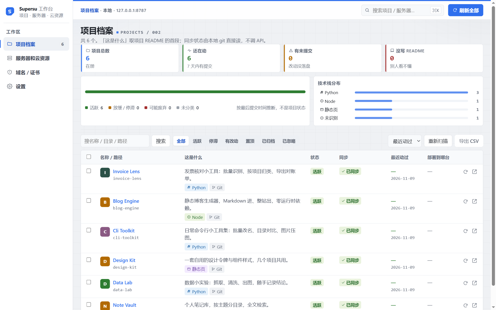
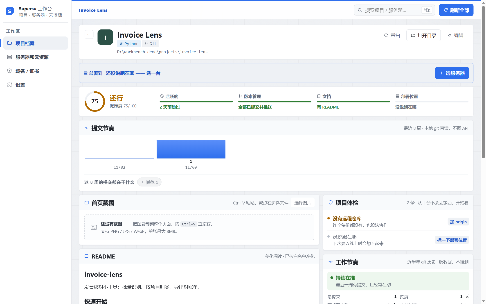
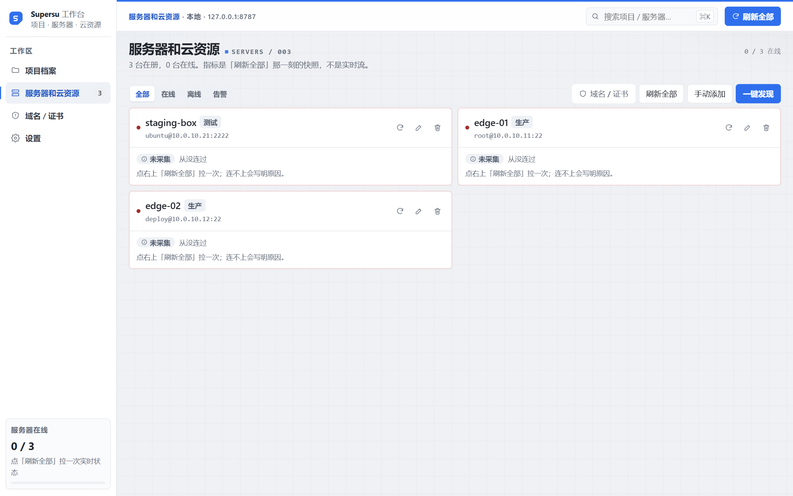
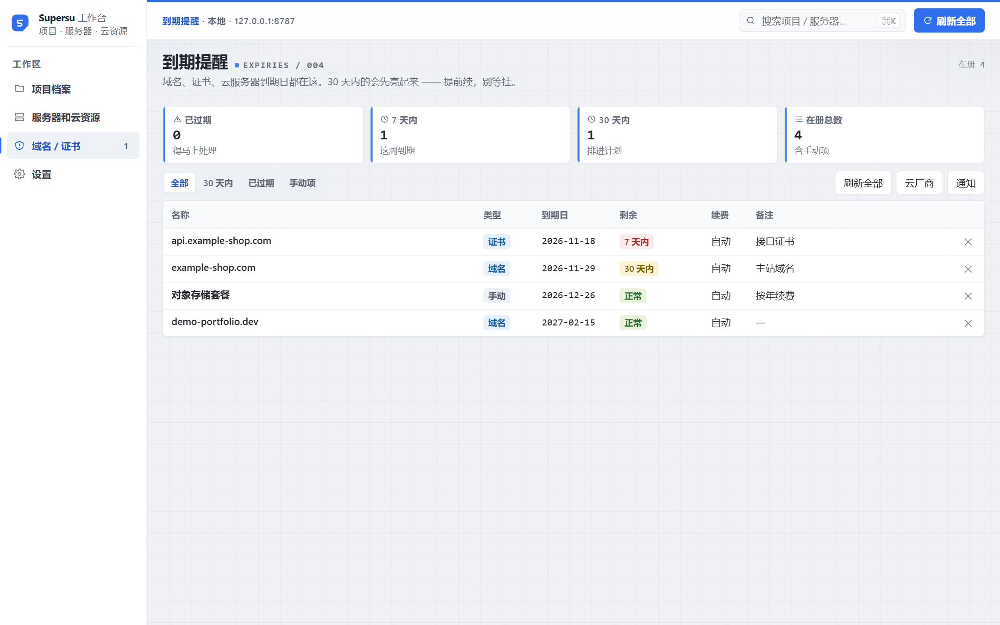

<div align="center">



# Supersu 工作台

**把散落在硬盘和云上的项目，收进一页看得懂的台面。**

双击就能跑 · 数据全在本机 · 不需要 Docker / 数据库服务 / 注册账号

[](https://www.python.org/)
[](https://flask.palletsprojects.com/)
[](https://www.sqlite.org/)
[](#开发与测试)
[](LICENSE)

</div>

---

## 你是不是也有这些文件夹

`test2`、`new-project`、`final-final`、`新建文件夹(3)` —— 过两个月再打开，完全想不起是干什么的。

还有 3、4 台云服务器，每次都要翻聊天记录找 IP；域名和证书什么时候过期，全靠脑子记。

**Supersu 工作台就是为这件事做的**：给它几个根目录，它自己把项目认出来、把服务器连一遍、把到期日拉回来，全部塞进一页。

---

## 三十秒看懂

| 你现在的状态 | 用完以后 |
|---|---|
| 靠目录名猜项目是干嘛的 | 自动读 README 标题 + 首段，一句话说清「这是什么」 |
| 忘了哪台服务器跑哪个项目 | 项目详情里直接标「部署到哪台」，点进去看实时负载 |
| 证书到期当天才发现 | 域名 / 证书 / 云资源到期日汇总，到期前提醒 |
| 不知道哪些项目还在动 | 按最近提交自动分档：活跃 / 放缓 / 停滞 / 可能废弃 |
| 打开一堆终端敲命令 | 一个页面看完全部，**只读巡检**，不改你任何东西 |

---

## 界面

### 项目档案 · 一屏看清全部家当

<div align="center">

</div>

四个大数先回答「整体什么状况」，再往下逐行看细节。技术栈、Git 状态、未提交改动、部署到哪台，都是真实读出来的，不做估算。

### 项目详情 · README 按原样渲染

<div align="center">

</div>

截图（Ctrl+V 直接粘）、README 渲染（支持居中排版、图片、表格、折叠块）、提交记录，按「先看长相、再看说明、最后看历史」排列。

### 服务器 · SSH 只读巡检

<div align="center">

</div>

填地址 + 密码 / 私钥，点一次「刷新全部」，负载、内存、磁盘、容器、端口一次拉齐；连不上会明确告诉你原因，不会静默失败。

### 到期提醒 · 该续费的东西自己会说话

<div align="center">

</div>

域名走 RDAP / WHOIS 自动查，HTTPS 证书直连读有效期，腾讯云 / 阿里云 / 华为云填一次 AK/SK 就自动同步，也可以接自己的 API。

---

## 功能一览

| 模块 | 能做什么 |
|---|---|
| **项目档案** | 3 层目录扫描、自动命名（README 标题 0.90 / 清单 0.72 / 目录名 0.45）、活跃度四档、搜索筛选排序、分页、批量置顶/归档、CSV 导出（防公式注入） |
| **项目详情** | 首页截图（粘贴即存）、README 渲染（净化 + 本地图片直读）、最近提交、部署服务器关联 |
| **服务器** | SSH 只读巡检：负载 / 内存 / 磁盘 / 容器 / 端口，阈值告警，离线原因，四类认证（密码 / 私钥路径 / 私钥内容 / Agent） |
| **到期提醒** | 域名、HTTPS 证书、云厂商资源、自定义 API；5 档紧急度；续费标记 |
| **通知** | 钉钉（含加签）、企业微信、自定义 Webhook、SMTP 邮件，24 小时内同一条不重复发 |
| **设置** | 界面开关、扫描根目录、活跃度口径、配置导出（凭据自动脱敏）/ 导入 |
| **审计** | 所有写操作留痕，页面上可倒查 |

---

## 三步跑起来

**① 双击 `start.bat`**（首次会自动建虚拟环境、装依赖，约 1–3 分钟）

**② 浏览器自动打开** `http://127.0.0.1:8787`

**③ 添加根目录**（比如 `D:\work`）→ 点「重新扫描」

> macOS / Linux：`python -m venv .venv && .venv/bin/pip install -r requirements.txt && .venv/bin/python app.py`

手动装依赖：

```bash
pip install -r requirements.txt
python app.py
```

改了模板或后端代码后**必须重启进程**（`start.bat` 窗口关掉重开）；只按 F5 刷新页面不会加载新模板。

---

## 为什么可以放心用

**它只看不改。**

- 项目目录**严格只读**：不写文件、不改配置、不执行项目里的任何命令
- 服务器**只跑白名单里的只读命令**：`uptime` / `free` / `df` / `docker ps` 这类，不做部署、不改 SSH 配置、不传文件
- 只监听 `127.0.0.1`，**不对公网开端口**
- 所有数据都在本地 `data/` 目录（SQLite），删掉整个文件夹就等于卸载干净
- 凭据只存在本机数据库里，导出配置时会自动脱敏

---

## 技术栈

```
Python 3.10+ · Flask 3 · Waitress · SQLite (WAL) · APScheduler
前端零框架：Jinja2 + 原生 JS + 少量 CSS 令牌（无构建步骤）
SSH：paramiko    抓取：httpx / requests
```

目录结构：

```
app.py                启动入口（查端口 → 起服务 → 退出收尾）
wb/                   业务代码：扫描 / SSH / 巡检 / 到期 / 通知 / 调度 / 安全
templates/ static/    模板与前端资源（static/vendor 为第三方库）
data/                 运行时数据：workbench.db、日志（不入库、不打包）
tests/                自研测试执行器 + 用例
scripts/build_dist.py 打包发布（白名单 + 泄漏断言 + zip + sha256）
```

---

## 开发与测试

```bash
python tests/run_all.py          # 唯一允许得出「全绿」的入口
python tests/run_all.py -v       # 失败时打印堆栈
```

- 退出码即结论：`0` 全绿、`1` 有失败、`3` 有未登记跳过、`5` 用例数低于基线
- 写代码前先读 `CONTRIBUTING.md`：错误必须显式报，不允许静默兜底

---

## 已知限制

- **Windows 优先**：磁盘/进程相关能力按 Windows 实现，其它平台能用但部分指标会缺
- 旧版的 `config.json` / `workbench.db` 不自动迁移，需用「设置 → 导入配置」导一次
- 到期项保存成功后页面会立即刷新，"已添加"提示会被冲掉
- 列表页表头吸顶，窗口特别矮时滚动会看到工具条从表头下滑过

---

## 许可

MIT。第三方依赖许可见 [THIRD-PARTY-NOTICES.md](THIRD-PARTY-NOTICES.md)（paramiko 为 LGPL-2.1，随包附许可说明）。

<div align="center">
<sub>本项目为个人自用工具，不收集任何数据，不联网上报任何信息。</sub>
</div>
